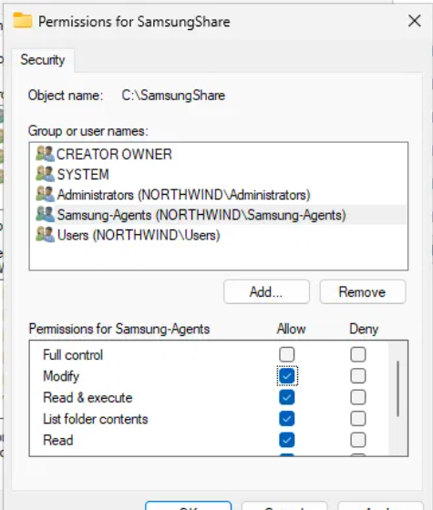

# Lab 01: Active Directory Home Lab

**Goal:** build a small company network on my own laptop and practice the Active Directory tasks a helpdesk handles every day.

**Environment:**

| Item | Value |
|------|-------|
| Hypervisor | VirtualBox 7.2 |
| Domain | `northwind.lab` |
| Domain controller | `DC01` (Windows Server: AD DS + DNS) |
| Client | `CLIENT01` (Windows, joined to the domain) |
| Network | VirtualBox NAT Network `LabNet`, `192.168.10.0/24` |

---

## 1. Domain setup

- Installed Windows Server and promoted it to a domain controller for `northwind.lab`.
- Configured the client's DNS to point to the domain controller and joined `CLIENT01` to the domain.

## 2. Organizational units, users and groups

- Created OUs to organize users by department.
- Created users and security groups (for example `Samsung-Agents`) and added users to them.

## 3. Helpdesk tickets: password reset and disabled account

- **Password reset** with "User must change password at next logon".
- **Disabled an account** to simulate an employee leaving the company (offboarding).

## 4. Group Policy (GPO)

- Created a GPO to **restrict access to Control Panel** and linked it to an OU.
- Applied it on the client with `gpupdate /force` and verified it.

## 5. Shared folder with share and NTFS permissions

- Created the shared folder `C:\SamsungShare`.
- Granted the `Samsung-Agents` group **Modify** at the NTFS level.
- Rule: the effective permission is the **most restrictive** combination of share and NTFS permissions.

## 6. DNS: blocking a website

- Created a DNS zone for `youtube.com` on the domain controller pointing to `127.0.0.1` (a DNS sinkhole), so clients that use the DC as their DNS server cannot reach the site.
- Verified it from the client with `nslookup` and `ping`.

## 7. Remote Desktop (RDP)

- Enabled Remote Desktop and connected to the client over port 3389 to provide remote support.

---

## Problems I solved

| Problem | Fix |
|---------|-----|
| VirtualBox would not start VMs because of a Hyper-V/WSL2 conflict | Disabled the Hyper-V features that were blocking VirtualBox |
| VM disk full | Cleaned temporary files and disabled hibernation with `powercfg /h off` |
| GPO not applying | The command was mistyped (`gpupdate / force`); the correct syntax is `gpupdate /force` |
| VMs used all 16 GB of RAM | Reduced VM memory and paused the lab when not in use |

## What I learned

- Why Active Directory depends on DNS: clients find the domain controller through DNS records.
- The difference between an **OU** (organizes objects and applies GPOs) and a **group** (assigns permissions).
- How share and NTFS permissions combine.
- Basic troubleshooting with `ipconfig`, `ping`, `nslookup` and `gpupdate`.
