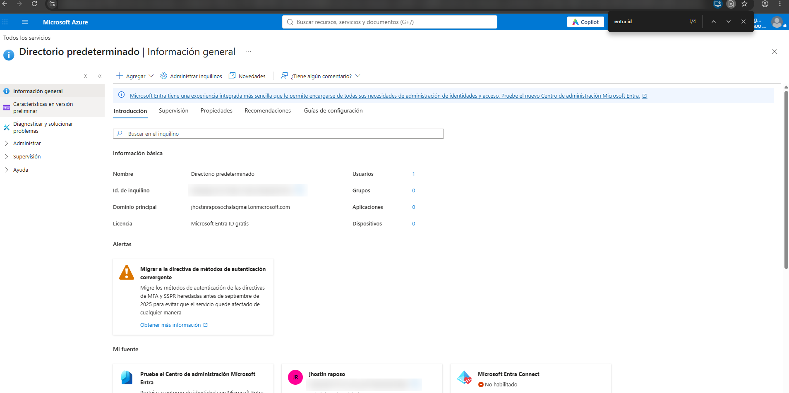
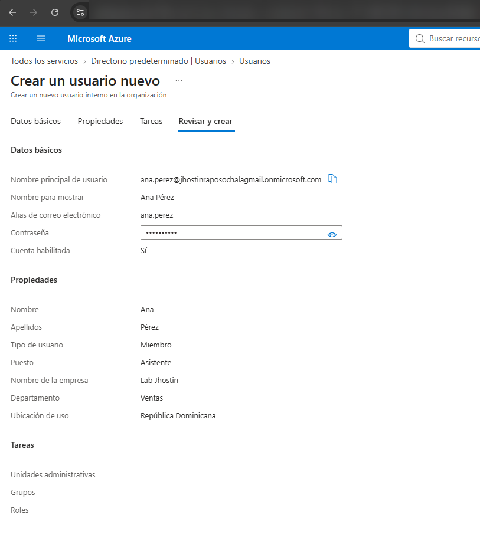
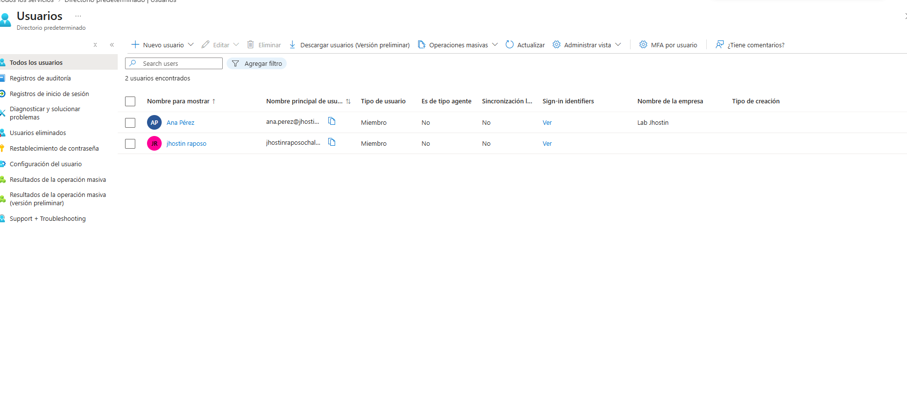
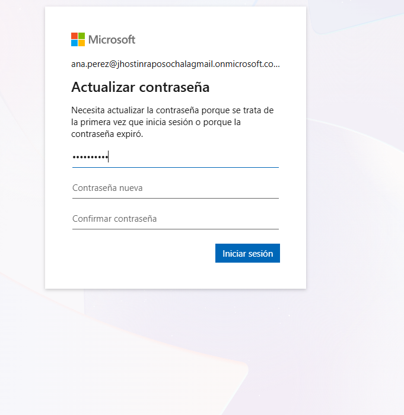
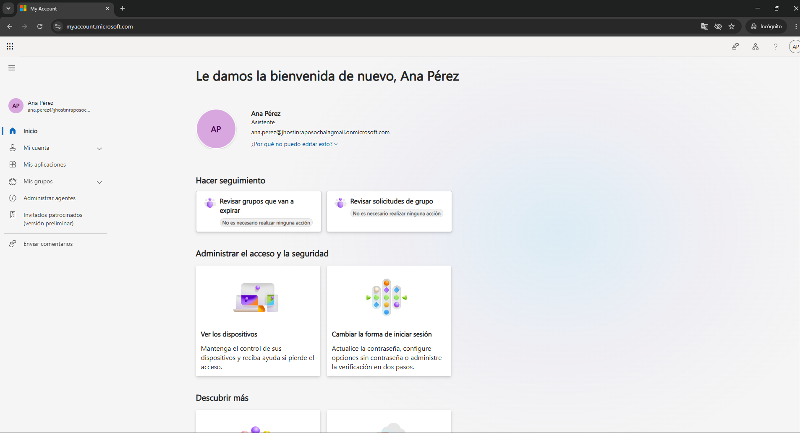
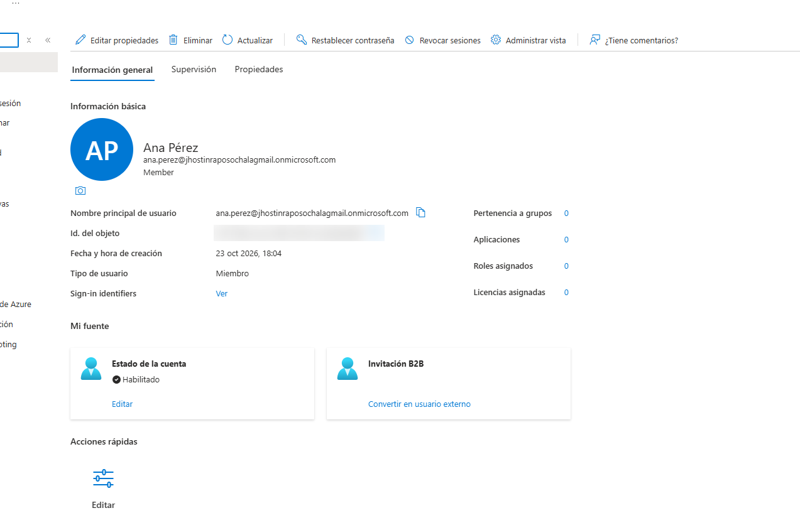
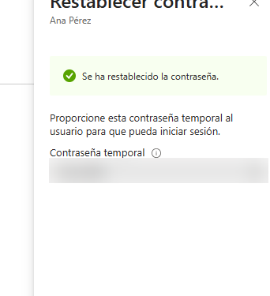
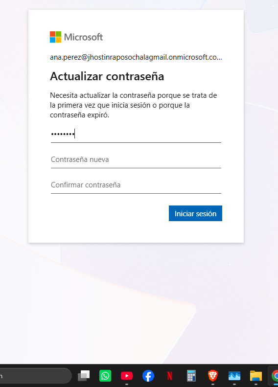

# Lab 02: Microsoft Entra ID

**Goal:** practice the cloud identity tasks a helpdesk handles every day in companies that use Microsoft 365: creating users, first sign-in, and password reset tickets.

**Environment:** Azure for Students subscription, Microsoft Entra ID Free tenant.

---

## 1. Tenant overview

Reviewed the default directory: primary domain (`*.onmicrosoft.com`), license (Entra ID Free) and object counts.

## 2. Onboarding: create a new user

Created the user **Ana Pérez** (Sales department, Assistant) with an auto-generated temporary password.

- **User principal name:** `ana.perez@<tenant>.onmicrosoft.com`
- **Job info:** job title, company name, department
- **Usage location:** Dominican Republic. Without a usage location, Microsoft 365 licenses cannot be assigned to the user.

## 3. First sign-in as the new user

Signed in as Ana in a private browser window at `myaccount.microsoft.com`. Entra ID forced a password change because the temporary password is single-use.

The user can see but **not edit** their job title and department. Only an administrator can change those attributes.

## 4. Ticket: "User forgot their password"

The most common helpdesk ticket, end to end:

1. **Verify identity** before resetting (call back on the registered number, employee ID or manager confirmation).
2. Reset the password from **Users → Ana Pérez → Reset password**.
3. Deliver the temporary password through a **secure channel**, never to a personal email.
4. The user signs in and is forced to set a new password.

---

## What I learned

- The full onboarding flow in Entra ID: create user, temporary password, forced change at first sign-in.
- Why **usage location** matters before assigning licenses.
- A password reset is a security process, not just a click: identity verification comes first.
- **Revoke sessions** signs a user out of all devices, which is used for compromised accounts and offboarding.

## Next steps

- [ ] Offboarding: block sign-in, revoke sessions, remove groups and licenses
- [ ] Security groups and dynamic groups
- [ ] MFA with security defaults and Microsoft Authenticator
- [ ] Sign-in logs: troubleshoot a failed login
