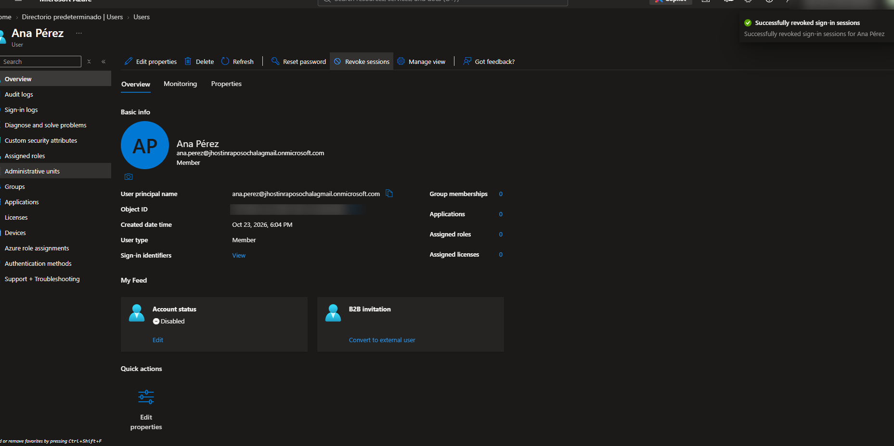
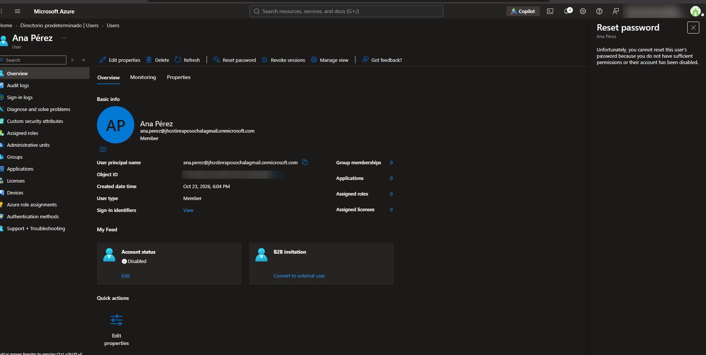
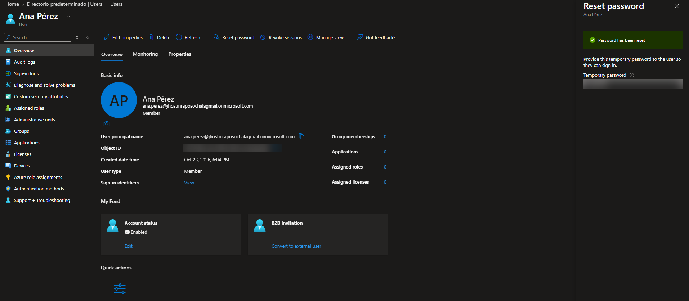
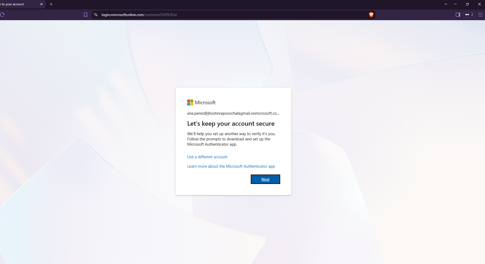
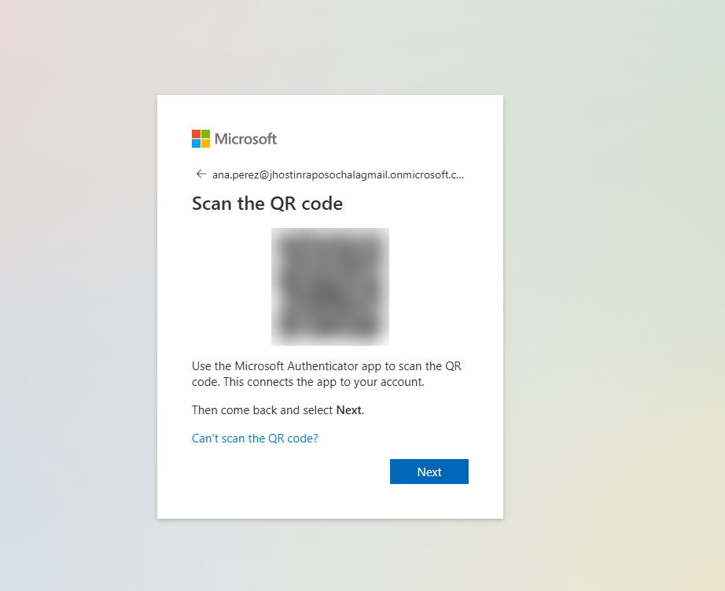
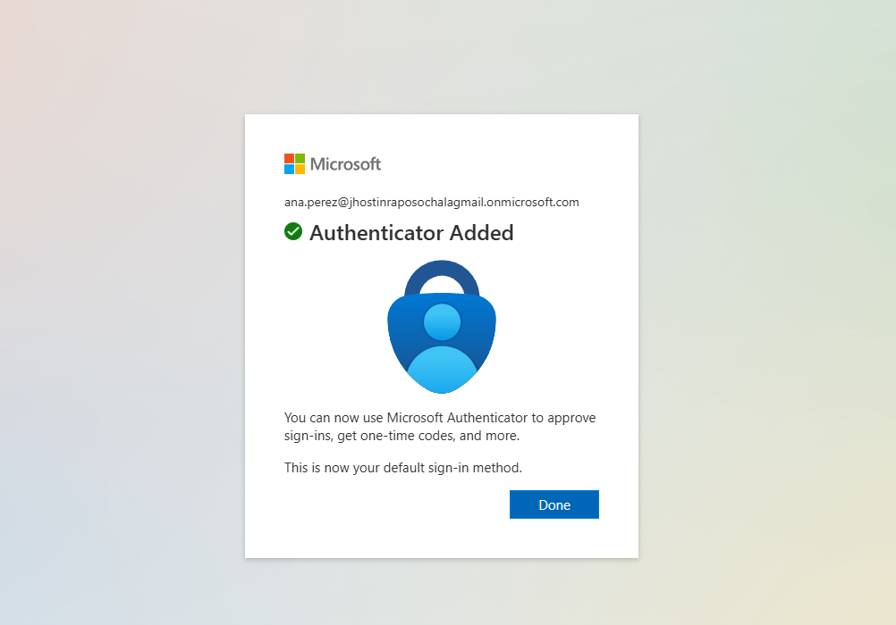
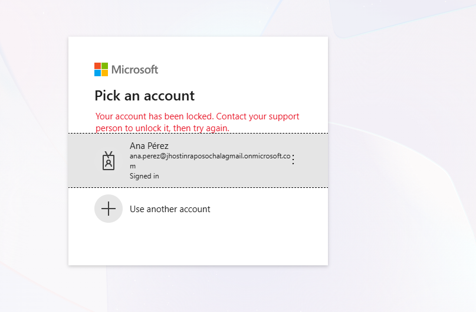
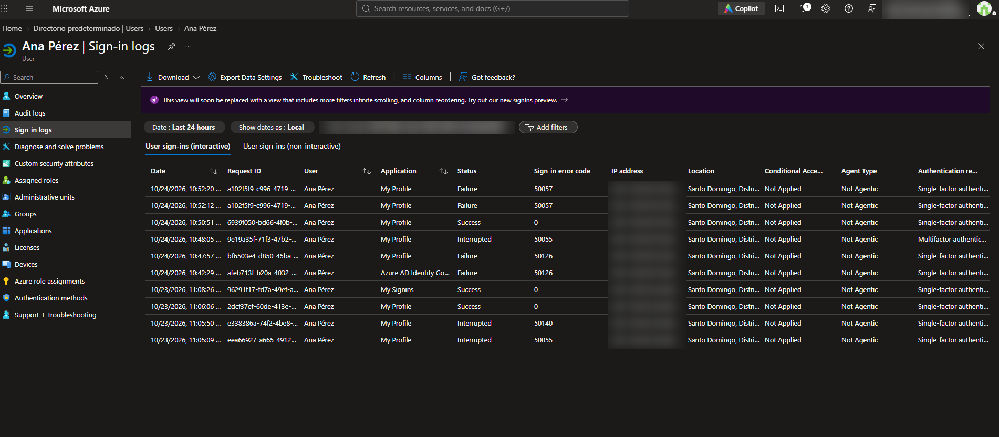

# Lab 02: Microsoft Entra ID

**Goal:** practice the cloud identity tasks a helpdesk handles every day in companies that use Microsoft 365: creating users, first sign-in, and password reset tickets.

**Environment:** Azure for Students subscription, Microsoft Entra ID Free tenant.

---

## 1. Tenant overview

Reviewed the default directory: primary domain (`*.onmicrosoft.com`), license (Entra ID Free) and object counts.

## 2. Onboarding: create a new user

Created the user **Ana Pérez** (Sales department, Assistant) with an auto-generated temporary password.

- **User principal name:** `ana.perez@<tenant>.onmicrosoft.com`
- **Job info:** job title, company name, department
- **Usage location:** Dominican Republic. Without a usage location, Microsoft 365 licenses cannot be assigned to the user.

## 3. First sign-in as the new user

Signed in as Ana in a private browser window at `myaccount.microsoft.com`. Entra ID forced a password change because the temporary password is single-use.

The user can see but **not edit** their job title and department. Only an administrator can change those attributes.

## 4. Ticket: "User forgot their password"

The most common helpdesk ticket, end to end:

1. **Verify identity** before resetting (call back on the registered number, employee ID or manager confirmation).
2. Reset the password from **Users → Ana Pérez → Reset password**.
3. Deliver the temporary password through a **secure channel**, never to a personal email.
4. The user signs in and is forced to set a new password.

## 5. Offboarding: "The employee left the company"

1. **Disabled the account** (Account status → Account enabled: off) instead of deleting it, so the company keeps the user's data and the account can be restored if needed.
2. **Revoked sessions** to sign the user out of every device.

**Lesson learned:** Entra ID does not allow resetting the password of a disabled account. To test the block, I had to **re-enable the account, reset the password, and disable it again**, the same flow as an employee who is rehired and later leaves.

## 6. MFA with Microsoft Authenticator

The tenant has **security defaults** enabled, so at sign-in the user was required to register Microsoft Authenticator. After registration, every sign-in needs approval on the phone.

## 7. Verifying the block

After disabling the account again and revoking sessions, the sign-in attempt was rejected and logged with error code `50057`:

## 8. Troubleshooting with sign-in logs

When a user calls saying "I can't sign in", the first step is to check **what error they get**. A wrong password and a disabled account are different problems with different fixes.

The **Sign-in logs** show every attempt with its error code:

| Code | Meaning |
|------|---------|
| `0` | Successful sign-in |
| `50126` | Invalid username or password |
| `50055` | Password expired, the user must change it |
| `50140` | "Stay signed in?" prompt (not an error) |
| `50057` | Account is disabled |

---

## What I learned

- The full user lifecycle in Entra ID: onboarding, first sign-in, password reset, MFA, offboarding and reactivation.
- Why **usage location** matters before assigning licenses.
- A password reset is a security process, not just a click: identity verification comes first.
- **Disable first, delete later:** offboarding keeps data available and allows rehiring.
- **Revoke sessions** signs a user out of all devices, used for compromised accounts and offboarding.
- How to read **sign-in logs** and error codes to troubleshoot login problems.
- MFA QR codes are secrets and must never be shared.

## Next steps

- [ ] Security groups and dynamic groups
- [ ] Self-service password reset (SSPR)
- [ ] Conditional Access (Entra ID P2 trial)
