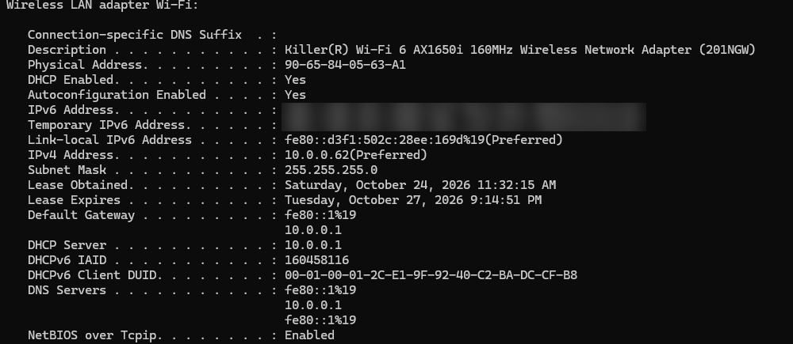
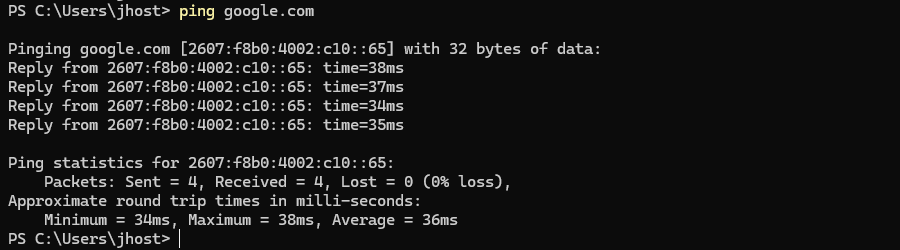
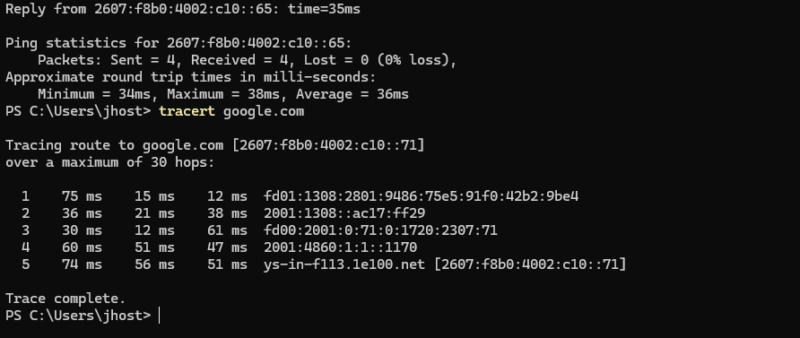
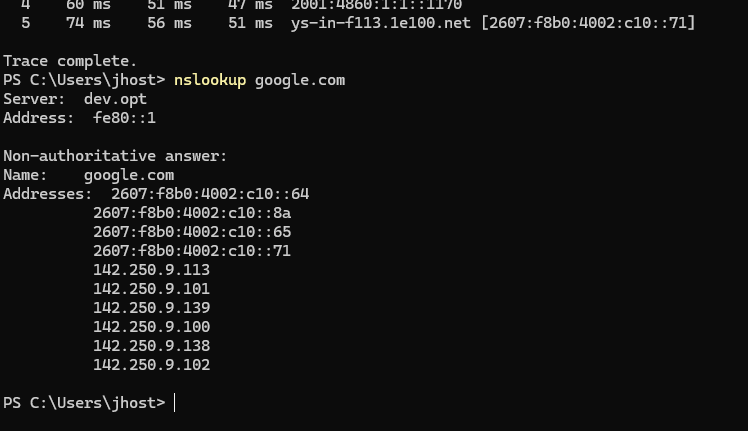
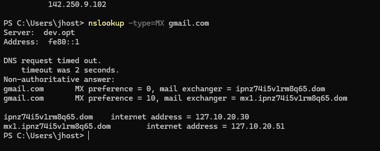
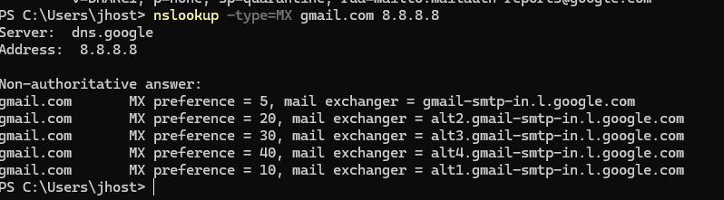
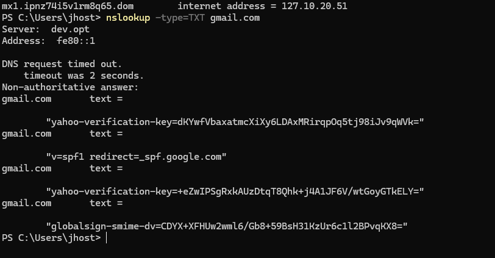
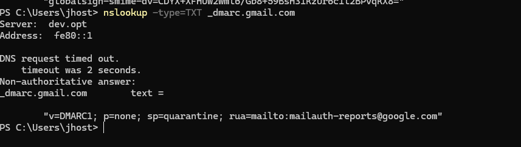

# Lab 03: Networking and Email DNS

**Goal:** practice the network troubleshooting commands a helpdesk uses every day and understand the DNS records behind email delivery.

**Environment:** my own Windows laptop on a home network (PowerShell).

---

## Part 1: Network troubleshooting commands

### `ipconfig /all`

Reviewed the Wi-Fi adapter configuration:

| Field | Value | Meaning |
|-------|-------|---------|
| IPv4 address | `10.0.0.62` | Private IP inside the home network |
| Subnet mask | `255.255.255.0` | /24 network, up to 254 hosts |
| Default gateway | `10.0.0.1` | The router, the exit to the internet |
| DHCP server | `10.0.0.1` | The router assigned the IP automatically |
| DNS server | `10.0.0.1` | The router also resolves names |
| Lease obtained / expires | 3-day lease | How long the IP is assigned |
| Physical address | `90-65-84-…` | MAC address of the network card |

The `192.168.56.1` adapter belongs to VirtualBox (host-only network used by my Active Directory lab).

### `ping`

0% packet loss and 36 ms average latency: the connection is healthy.

### `tracert`

Five hops from my router, through the ISP, to Google. Useful to find **where** a connection fails.

### `nslookup`

Name resolution through the router's DNS. "Non-authoritative" means the answer came from a cache, not from Google's own DNS servers. Google returns several IPs to balance the load.

---

## Part 2: Email DNS records

### MX records: where email for a domain is delivered

**Troubleshooting case:** querying the MX records of `gmail.com` through my router returned an invalid answer (`*.dom` hosts with `127.x.x.x` loopback addresses) after a timeout.

To confirm, I queried Google's public DNS directly (`nslookup -type=MX gmail.com 8.8.8.8`) and got the correct records. Conclusion: **the router's DNS was answering MX queries incorrectly**, not a problem with Gmail.

The **preference** value sets the order: the lowest number (`5`) is tried first and the others are backups.

### SPF: who is allowed to send email for the domain

`v=spf1 redirect=_spf.google.com` lists the servers authorized to send email as `@gmail.com`. Mail from any other server is suspicious.

### DMARC: what to do with email that fails checks

`v=DMARC1; p=none; sp=quarantine` tells receiving servers how to handle email that fails SPF/DKIM: `none` only reports, `quarantine` sends to spam, `reject` blocks it.

---

## What I learned

- How to read `ipconfig /all`: IP, mask, gateway, DHCP and DNS.
- `169.254.x.x` means the device did not get an IP from DHCP.
- If `ping 8.8.8.8` works but websites don't open, the problem is **DNS**.
- Compare against another DNS server (`8.8.8.8`) to confirm whether the local DNS is the problem.
- "Our emails go to spam" → check the domain's **SPF, DKIM and DMARC** records.

## Next steps

- [ ] Cisco Packet Tracer: VLANs, DHCP server and inter-VLAN routing
